# QA-Genius

**From a user story to a release decision — with a senior tester checking the AI's work.**

QA-Genius is a free, open-source workspace for QA engineers. Paste a user story and it checks how clear the story is, writes acceptance criteria and test cases, finds the ways the feature can break, plans which browsers and devices to test, writes Playwright code, and ends with one decision: **Ready to release**, **Release with known risks**, or **Not ready**.

🔗 **Live demo:** [qa-genius-ashy.vercel.app](https://qa-genius-ashy.vercel.app) · works with **Load example**, no key needed
🎬 _Demo video: coming soon_

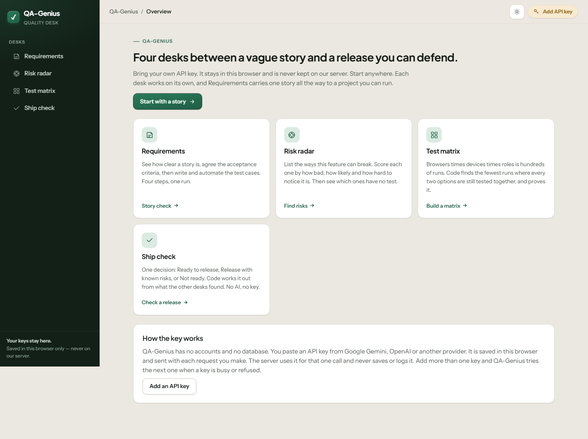

> The screenshots in this README are from the look before the redesign. Retake
> them with `python scripts/ui_screenshots.py` once the `redesign` branch is
> merged.

---

## Why not just ask ChatGPT?

You can ask any chat AI to "write test cases". You'll get a list — and then you have to check it, ask again, and remember what you asked last time. QA-Genius is built around three ideas a chat window doesn't have:

1. **A senior tester sits next to the AI.** Plain-code rules (no AI, no key) run in the same click. Before the AI answers, they tell it what a senior tester always checks for this kind of feature. After it answers, they add what's still missing and point out mistakes — like *"Nobody says what happens at exactly $50."*
2. **Code works out every number.** Coverage, risk scores, the release decision, the browser/device matrix — all computed by code from your results, never guessed by the AI. The same input always gives the same answer.
3. **Everything is connected.** The story, criteria, test cases, risks, matrix and code all know about each other. Change one criterion and every desk shows **"Old — your work changed"** with what changed.

### A real example

Story: *"As a shopper, I want to apply a discount coupon at checkout."* Context: *"Coupons work on orders of at least $50, with a maximum discount of $30."* With criteria that say *"more than $50"* and *"less than $50"*, QA-Genius reports — in one click, without being asked:

- **"AC-1 covers 'more than $50' and AC-2 covers 'less than $50'. Nobody says what happens at exactly $50. Decide, then add it to a criterion."**
- **"The context says 'at least $50' (so exactly $50 works) but AC-1 says 'more than $50' (so exactly $50 doesn't). Decide which is right."**
- **"TC-016 expects a valid coupon code of exactly $50.00 to be accepted, but AC-1 says 'more than $50', so exactly $50.00 should be refused. One of them is wrong."**
- Tests at **$49.99 / $50.00 / $50.01**, and where the $30 cap starts: **$149.99 / $150.00 / $150.01**.
- Tests for removing items after the coupon is applied, cent rounding, a guest reusing the coupon, and two browser tabs using the same coupon at once.

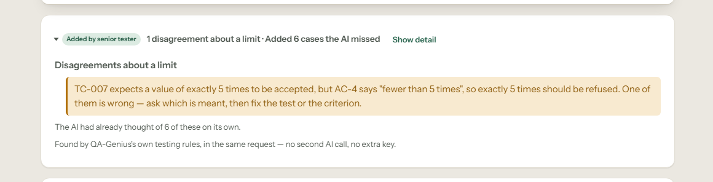

---

## What's inside

### 1. Requirements — story to test cases to code

Four steps: **Story → Acceptance criteria → Test cases → Automation.**

- **Story check** scores how clear the story is, runs the INVEST check, names unclear words and suggests better ones, and writes acceptance criteria. It warns when a "story" is really several features. **Use these criteria** carries the story and its criteria to step 2, where you can edit, reorder, add and delete them.
- **Two-reader check** asks two AI readers (one strict, one relaxed) to read the story separately and shows where they disagree, right in the story text. Numbers are compared by code, so "same" and "different" are worked out, not guessed.
- **Test cases** are written from your criteria. Each test shows which criteria it covers. The page shows how well each criterion is tested (wrong input, at the limit), and **Add more tests where needed** fills only the gaps — with a before/after view, **Accept**, **Keep current** and **Undo last change**. Download the suite as CSV or Excel.
- **Automation** turns up to twelve tests you tick into a Playwright, Cypress or Selenium project. Code then checks it: every test linked to its test case, a quick code check, fixed pauses and tests that never check anything flagged. **Download ZIP**.

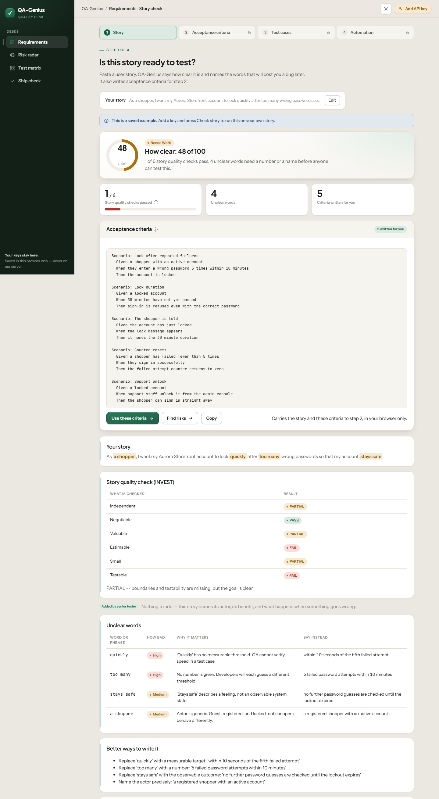
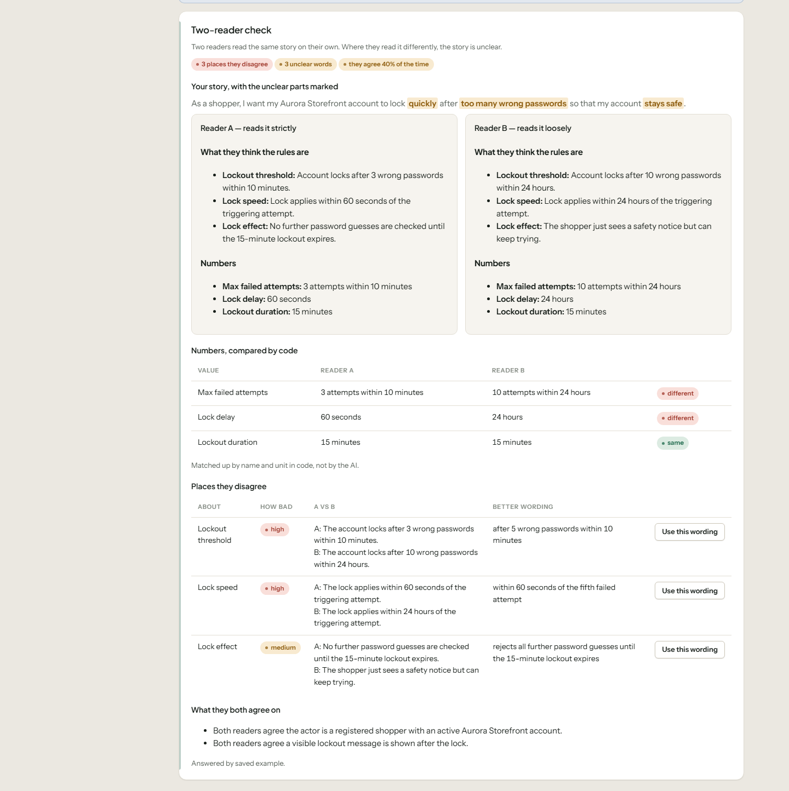
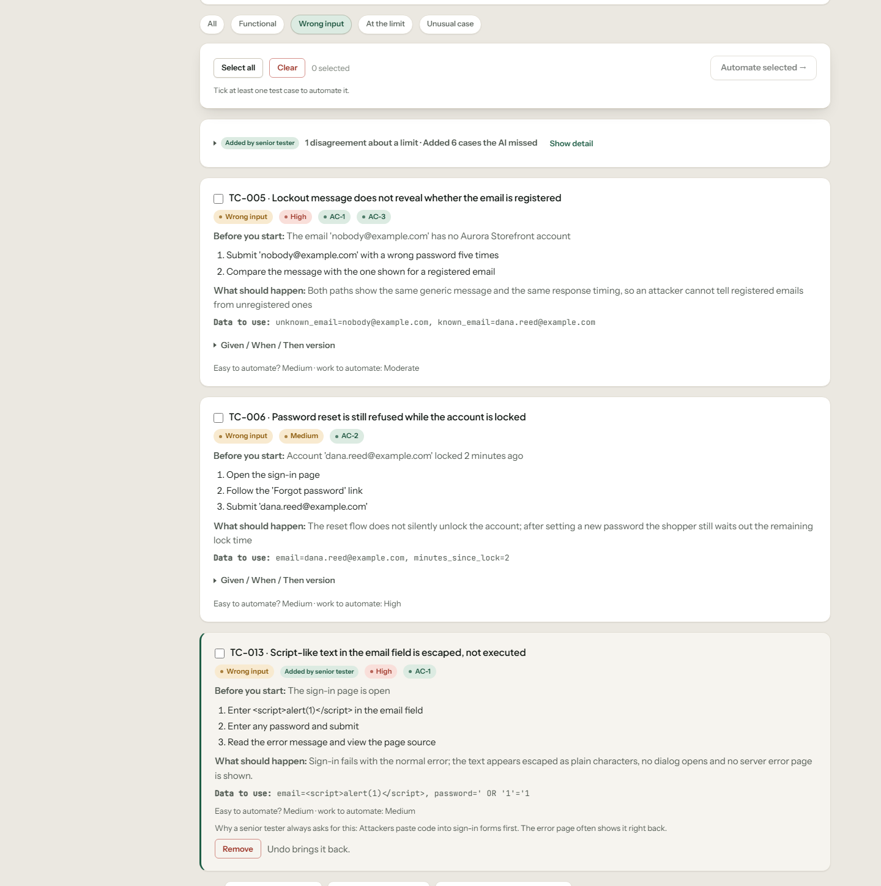
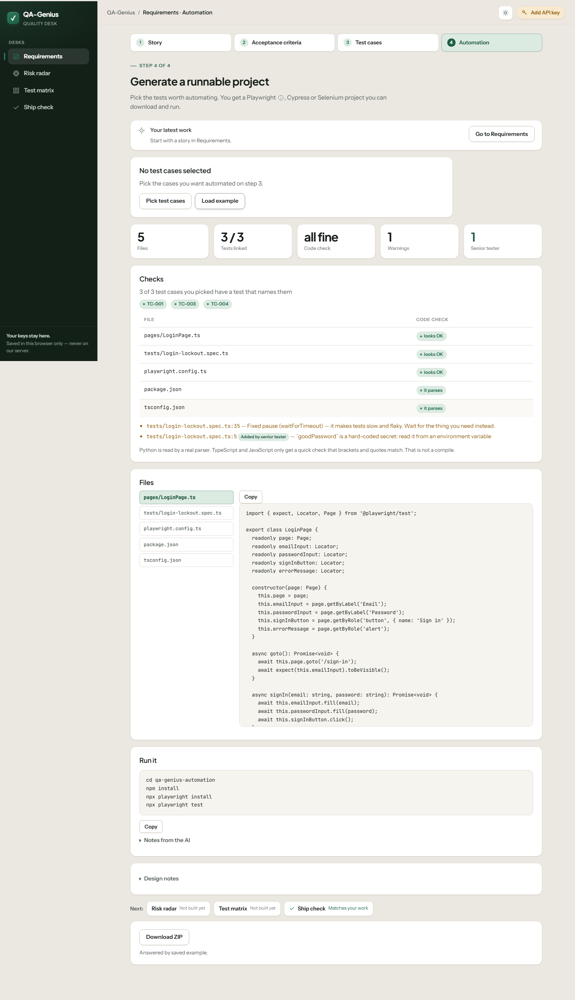

### 2. Risk radar — where will this break?

Lists the ways the feature can break (security, speed, reliability, data, accessibility…). Each risk gets three scores — **how bad × how likely × how hard to notice** — and code works out the risk score, the risk map and the order. It checks whether a test already covers each risk, and **Write tests for N high risks with no test** closes the gap. Download the risk register as CSV or Excel.

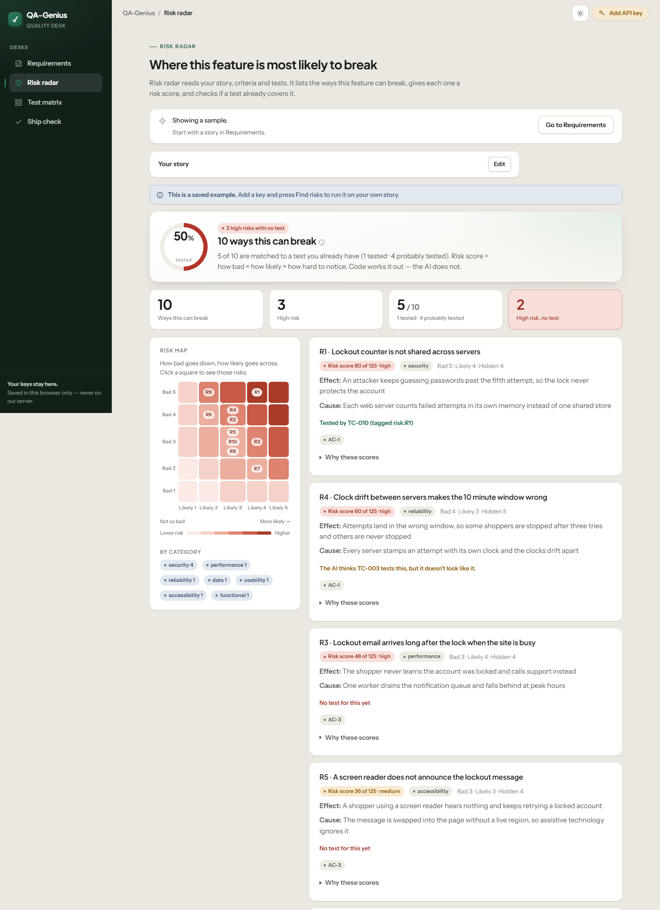

### 3. Test matrix — which browsers and devices?

Browsers × devices × roles × languages is hundreds of combinations. QA-Genius suggests what to vary for your story, then code finds the **fewest runs where every two options are tested together** — the saved example goes from 216 combinations to 16 runs — and proves it ("85 of 85 pairs covered"). Download a ready Playwright config.

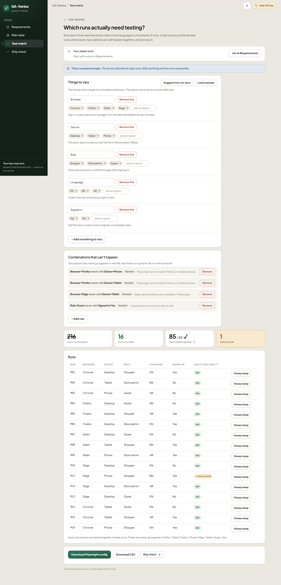

### Several stories

Work on more than one story and keep them all. **Save draft** gives a story an ID you
choose (`CART-204`) or one we number for you (`S-001`), and a status — *Draft*, *Ready
for review* or *Done*. The Overview switches between them with `‹ Story 2 of 5 ›`, and
**My stories** lists every one with its criteria, tests, high risks with no test and the
release decision it last got.

Saved stories live in this browser until you delete them. **Export all (JSON)** writes
them to one file you can keep or move to another computer, and **Import** brings them
back. A loaded example is never saved over your work — press **Keep this as my story**
if you want it.

### 4. Ship check — can we release?

One decision from everything above, computed by code with **no AI**. Seven checks: **How clear the story is**, **Two-reader check**, **Criteria with a test**, **How well tested**, **Risks with a test**, **Automation** and **Test matrix**. A failed check can be accepted with a written reason, and optionally an **owner** and a
**review by** date; once that date has gone by the acceptance stops counting and the
check goes back to *check this*. Each report also gets a **grade** (A+ to F) worked out
from the checks that ran — press the letter for the sums behind it. A release the rules
call *Not ready* is never graded above D. **Copy as Markdown** or **Print / save as
PDF**.

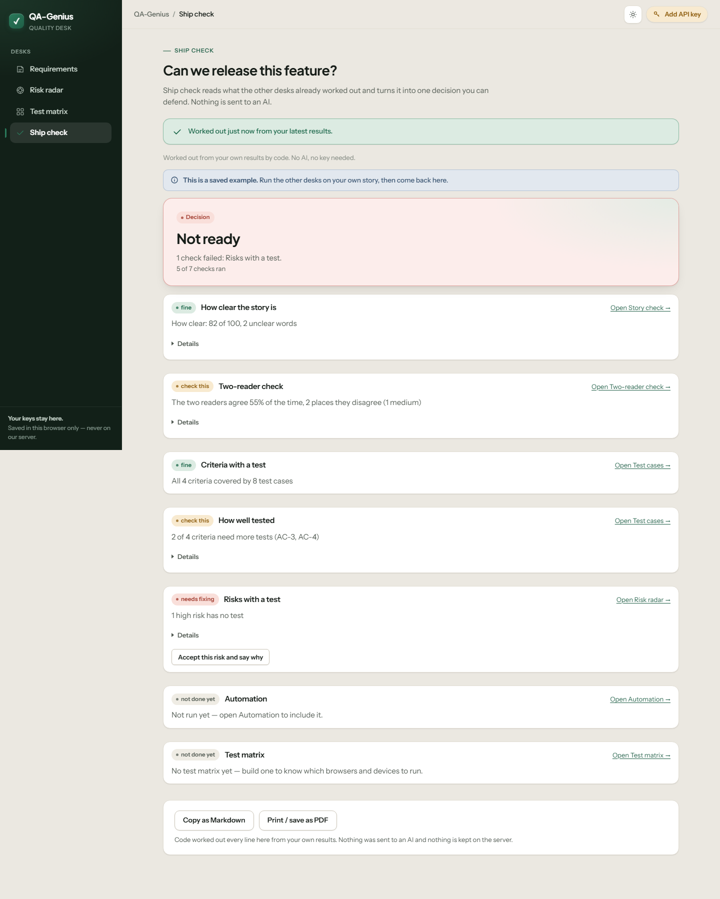

### Always up to date

Every desk shows what it was built from — **Not built yet**, **Old — your work changed**, or **Matches your latest work** — and the left menu shows a dot or a tick. Anything code can redo updates by itself; anything that uses your AI key waits for your click.

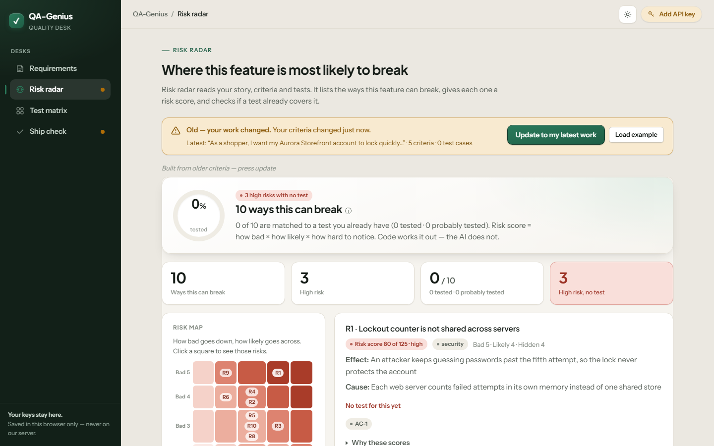

---

## Your key, your data

- **Bring your own AI key.** The key drawer lists **Google Gemini (free)**, **Groq (free)**, **OpenAI (GPT)**, **xAI (Grok)**, **Mistral**, **Anthropic (Claude)** and **OpenRouter**. Add more than one — if one is busy or refused, the next one answers.
- **Keys stay in your browser** (`localStorage`). They are sent only with requests that need the AI, and the server never stores or logs them.
- **The story you are working on stays in this tab** (`sessionStorage`) and goes when the tab closes.
- **Stories you save stay in this browser** (`localStorage`) **until you delete them**. There is no database and no account: `My stories` lists them, and **Delete all my stories** really deletes them.
- **Load example** on every desk works with no key at all.

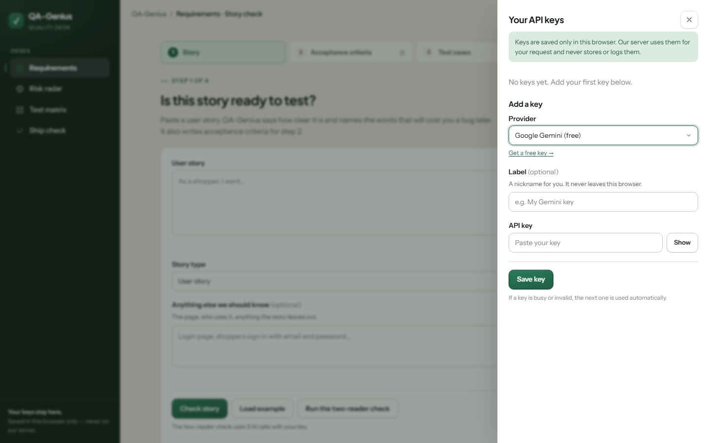

---

## Run it on your computer

You need **Python 3.12+**.

```bash
git clone https://github.com/Yusuf-Hridoy/QA-Genius.git
cd QA-Genius
python -m venv .venv
# Windows:  .venv\Scripts\activate
# Mac/Linux: source .venv/bin/activate
pip install -r requirements.txt
uvicorn main:app --reload
```

Open **http://127.0.0.1:8000**, click **Add AI key** (top right), and paste a key. A free Gemini key: [aistudio.google.com/app/apikey](https://aistudio.google.com/app/apikey).

Check one key from the terminal (the key is never printed):

```bash
python scripts/check_key.py
```

## Put it online (Vercel)

QA-Genius runs on Vercel's free plan with no extra setup. There is no `vercel.json`: Vercel finds `app` in `main.py` and installs `requirements.txt` by itself.

1. Push the repo to GitHub.
2. On [vercel.com](https://vercel.com) → **Add New → Project** → import the repo → **Deploy**.
3. Open `/health` on your new link — it should answer `"ok"`.

No environment variables are needed: users bring their own keys.

---

## How it's built

- **Python + FastAPI** on the server, **Jinja2** templates, **HTMX** and a little plain JavaScript in the browser. No React, no database.
- The **OpenAI Python library** talks to every provider through their OpenAI-compatible endpoints.
- **"Code computes, AI writes."** The AI writes text. Code computes every number and decision, and checks the AI's output (made-up numbers, wrong test ids, unsafe file names).
- **1,300+ automated tests** (pytest) plus **66 browser-side unit tests** (Node's built-in test runner).

```
main.py                     entry point (Vercel looks for `app` here)
qagenius/
  web.py                    routes
  models.py                 the field names every desk shares
  llm.py, providers.py      AI calls, key rotation, fallback
  prompts.py                AI instructions
  test_cases.py, test_case_depth.py, test_case_refine.py   test cases and "how well tested"
  risk_radar.py             risk scores and coverage
  pairwise.py               the test matrix maths
  ship_check.py             the release decision
  automation_checks.py      checks on generated code
  shadow_qa/                the senior tester
    packs/*.toml            rule packs, one per kind of feature
  samples/                  the saved answers behind every Load example
  templates/                pages
public/                     CSS and browser JavaScript
tests/                      pytest and JS tests
scripts/                    check_key.py, ui_screenshots.py, shadow_qa_screens.py
```

### Also in the app, not in the menu

**Bug desk** (`/bugs`) turns rough notes and a screenshot into a structured report with code-computed quality checks and Markdown/Jira exports. **Quality insights** (`/insights`) reads JUnit or Playwright reports with no key at all, groups failures and names flaky tests. Both work and are tested; they are simply not in the sidebar.

## Add your own senior-tester rules

The senior tester's knowledge lives in `qagenius/shadow_qa/packs/*.toml` — one file per kind of feature (login, file upload, coupons, permissions, two-factor, payments and more). Add a file and it's picked up. A pack wakes up on a word only its kind of feature uses (`triggers`); common words go in `weak_triggers` and need two to wake it.

A check that is only about one narrow thing carries `only_if` and waits until your story raises that subject, so a lockout story is never asked for a test about languages.

```toml
id = "gift_cards"
name = "Gift cards"
short = "Gift cards"
triggers = ["gift card", "gift cards"]
weak_triggers = ["balance", "redeem"]

[[checks]]
id = "partial_balance"
title = "A gift card pays part of the order and keeps the rest"
severity = "high"
why = "People expect the rest of their balance to stay on the card."
covered_if = ["remaining balance", "partial", "rest of the balance"]
only_if = []          # optional: use this check only when the story says one of these
  [checks.test]
  title = "Pay a $30 order with a $50 gift card"
  category = "Functional"
  priority = "High"
  pre_conditions = "A gift card GC-1001 has a $50 balance"
  steps = ["Add $30 of items to the cart", "Pay with GC-1001", "Check the gift card balance"]
  expected_result = "The order is paid and GC-1001 shows a $20 balance."
  test_data = "card=GC-1001, balance=50.00, order=30.00"
```

`severity` is `high`, `medium` or `low`. `category` is `Functional`, `Negative`, `Boundary` or `Edge Case`, and `priority` is `High`, `Medium` or `Low`. A test needs at least two steps. A bad file names itself in the error.

## Development

```bash
pip install -e ".[dev]"
pytest -q                          # Python tests
ruff check .                       # lint
node --test tests/js/*.test.mjs    # browser-side tests
```

All three must pass before a commit.

**Screenshots of every page.** `python scripts/ui_screenshots.py` saves a PNG of every desk at 1366×900 and 390×844 into `ui-screens/` (git-ignored), so a UI change can be compared side by side instead of described. It starts nothing itself:

```bash
pip install playwright          # a dev dependency, not in requirements.txt
playwright install chromium
uvicorn main:app --reload          # in one terminal
python scripts/ui_screenshots.py   # in another
```

Pass a different base URL as the one argument, e.g. `python scripts/ui_screenshots.py http://localhost:9000`. Every page is shot empty or through its own **Load example** button, so no API key is needed and no request reaches a provider.

**Plain words.** Every word on a screen is meant to be readable by a tester in their first month, or by one whose first language is not English. The few standard words that stay — acceptance criteria, test case, at the limit, wrong input, INVEST, risk score, Playwright, given/when/then — carry a small ⓘ. Those notes live in one place, `public/plain_words.js`, and a template reaches one with `data-explain="boundary"`. `tests/test_plain_words.py` renders every page and fails if a banned word reaches a screen.

**Checking a key.** `python scripts/check_key.py` checks one provider key with a tiny JSON request. It asks for the provider id and the key (hidden while typing) and prints `OK <provider> <model>` or the cleaned error. The key is never printed.

## Honest limits

- The AI can still be wrong. The senior tester and the code checks catch many mistakes, not all. Always read what you use.
- The senior tester's rules match words and numbers — they don't truly understand your product. Unusual domains need new rule packs.
- TypeScript and JavaScript code gets a quick check that brackets, quotes and comments match. It is not a compile and not a type check.
- Free AI keys have rate limits. If a key is busy, add a second one.

## About

Built by **Md Yusuf Ahmed**, QA Automation Engineer — [GitHub](https://github.com/Yusuf-Hridoy) · _LinkedIn: (https://www.linkedin.com/in/md-yusuf-ahmed/)

The first version (a Streamlit app) is kept on the `archive/v1-streamlit` branch.

License: MIT
